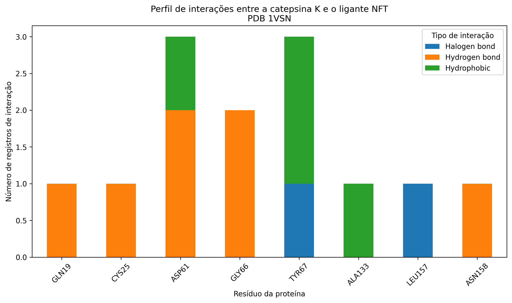

# Reproducibility of Protein–Ligand Interactions in PDB 1VSN using PLIP
[](https://colab.research.google.com/github/shirleymilitao/PLIP-1VSN-reproducibility/blob/main/notebooks/PLIP_1VSN_Reprodutibilidade.ipynb)

Reprodução computacional do perfil de interações proteína–ligante da estrutura cristalográfica **PDB 1VSN**, utilizando o **Protein–Ligand Interaction Profiler (PLIP)**.

## Sobre o projeto

Este projeto foi desenvolvido como um exercício de **bioinformática reprodutível**, com o objetivo de reproduzir uma parte delimitada da análise apresentada por Salentin et al. (2015).

O estudo concentra-se no perfil de interações entre a **catepsina K humana** e o ligante **NFT** presente na estrutura cristalográfica **PDB 1VSN**.

O objetivo não é reproduzir integralmente o artigo original, mas avaliar a reprodutibilidade de uma análise estrutural específica utilizando uma versão atual do PLIP.

## Pergunta científica

> Quais interações não covalentes entre o ligante NFT e a catepsina K são identificadas pelo PLIP na estrutura experimental PDB 1VSN?

## Estrutura analisada

| Característica | Informação |
|---|---|
| PDB | 1VSN |
| Proteína | Catepsina K humana |
| Ligante | NFT |
| Cadeia | A |
| Resíduo do ligante | 283 |
| Método experimental | Difração de raios X |

## Referência principal

Salentin S, Schreiber S, Haupt VJ, Adasme MF, Schroeder M.  
**PLIP: fully automated protein-ligand interaction profiler.**  
*Nucleic Acids Research*. 2015.  
DOI: 10.1093/nar/gkv315

## Workflow

O experimento foi organizado nas seguintes etapas:

1. preparação do ambiente computacional;
2. download automático da estrutura PDB 1VSN;
3. inspeção da estrutura;
4. identificação do ligante NFT;
5. identificação exploratória dos resíduos próximos ao ligante;
6. análise das interações proteína–ligante com PLIP;
7. extração programática dos resultados;
8. organização e exportação dos resultados em formato CSV;
9. geração das visualizações;
10. investigação das moléculas de água cristalográficas;
11. registro das versões do ambiente computacional;
12. execução de testes automáticos de reprodutibilidade.

## Resultados

A análise com **PLIP 3.0.1** identificou **13 registros de interação** entre o ligante NFT e a catepsina K.

| Tipo de interação | Número de registros |
|---|---:|
| Ligações de hidrogênio | 7 |
| Contatos hidrofóbicos | 4 |
| Ligações de halogênio | 2 |
| **Total** | **13** |

Foram identificados **8 resíduos distintos** envolvidos nas interações:

- GLN19
- CYS25
- ASP61
- GLY66
- TYR67
- ALA133
- LEU157
- ASN158

Entre esses resíduos, **ASP61** e **TYR67** apresentaram o maior número de registros de interação.

ASP61 apresentou duas ligações de hidrogênio e um contato hidrofóbico.

TYR67 apresentou dois contatos hidrofóbicos e uma ligação de halogênio.

## Investigação das pontes de água

A estrutura 1VSN contém **269 moléculas de água cristalográficas**.

Na análise geométrica realizada neste projeto:

- 14 águas foram encontradas a até 5 Å do ligante NFT;
- 11 apresentaram distância mínima ao NFT dentro do intervalo de 2,5–4,1 Å observado nos parâmetros do PLIP 3.0.1.

Apesar da presença de moléculas de água próximas ao ligante, nenhuma interação foi classificada como `Water Bridge` pelo PLIP 3.0.1 nesta execução.

A referência original descreve interações mediadas por água para a pose cristalográfica analisada.

Portanto, essa característica não foi reproduzida na execução atual.

A causa específica dessa diferença não foi determinada neste experimento. Possíveis efeitos de versão do software, preparação estrutural ou critérios geométricos podem ser investigados futuramente, mas não são considerados explicações comprovadas neste trabalho.

## Avaliação da reprodutibilidade

Os resultados são caracterizados como uma **reprodução parcial do perfil de interações da pose cristalográfica de 1VSN**.

Foi observada concordância qualitativa em características relevantes da análise de referência, especialmente na identificação das ligações de halogênio.

Entretanto, as pontes de água descritas na literatura não foram reproduzidas com PLIP 3.0.1.

Essa divergência foi mantida e documentada como parte do próprio resultado da avaliação de reprodutibilidade.

### Reprodutibilidade computacional

O notebook foi posteriormente executado do início ao fim em ambiente limpo.

Os testes automáticos confirmaram:

- 13 registros totais de interação;
- 7 ligações de hidrogênio;
- 4 contatos hidrofóbicos;
- 2 ligações de halogênio;
- 8 resíduos únicos.

Todos os testes automáticos foram aprovados.

## Visualização dos resultados

A figura abaixo apresenta o perfil de interações identificado pelo PLIP para os resíduos da catepsina K envolvidos na interação com o ligante NFT.



O gráfico mostra que diferentes resíduos podem participar de diferentes categorias de interação. ASP61 e TYR67 apresentam o maior número de registros, enquanto GLY66 participa de duas ligações de hidrogênio.

## Ambiente computacional

A execução utilizada para validar este experimento apresentou o seguinte ambiente:

| Ferramenta | Versão |
|---|---:|
| Python | 3.13.16 |
| PLIP | 3.0.1 |
| Open Babel | 3.2.1 |
| pandas | 2.2.3 |
| NumPy | 2.1.3 |
| Matplotlib | 3.10.0 |

As dependências Python utilizadas estão registradas em:

`environment/requirements.txt`

As versões observadas durante a execução também estão documentadas em:

`environment/environment_versions.txt`

O Open Babel constitui uma dependência importante do PLIP e sua instalação pode variar entre sistemas operacionais.

## Como reproduzir

O workflow principal está disponível em:

`notebooks/PLIP_1VSN_Reprodutibilidade.ipynb`

### Google Colab

O notebook foi preparado para execução sequencial no Google Colab.

Para reproduzir a análise:

1. abra o notebook no Google Colab;
2. utilize um ambiente de execução Python;
3. execute as células sequencialmente do início ao fim;
4. aguarde a instalação das dependências e a execução do PLIP;
5. verifique os testes automáticos ao final.

O próprio notebook realiza o download da estrutura PDB 1VSN, instala as ferramentas necessárias, executa o PLIP, extrai os resultados, gera os arquivos derivados e realiza os testes de reprodutibilidade.

### Resultado esperado

Ao final da execução deverá aparecer:

`Todos os testes foram aprovados.`

Os principais valores esperados para o ambiente validado são:

- 13 registros de interação;
- 7 ligações de hidrogênio;
- 4 contatos hidrofóbicos;
- 2 ligações de halogênio;
- 8 resíduos únicos.

Uma alteração nesses valores em outro ambiente ou versão de software deve ser investigada em vez de ser automaticamente interpretada como erro.

## Limitações

Este projeto não representa uma reprodução integral do artigo de Salentin et al. (2015).

O escopo foi deliberadamente limitado à análise do perfil de interações da pose cristalográfica do complexo PDB 1VSN.

O experimento também utiliza uma versão atual do PLIP, diferente daquela disponível no período da publicação original.

Além disso, embora tenham sido investigadas as moléculas de água próximas ao ligante, não foi realizada uma reimplementação independente dos critérios geométricos utilizados pelo PLIP para classificação de pontes de água.

Portanto, a divergência observada para `Water Bridges` permanece documentada, mas sua causa específica não foi estabelecida.

## Conclusão

A análise reproduziu parcialmente o perfil de interações proteína–ligante da pose cristalográfica da estrutura PDB 1VSN.

Foram identificadas de maneira reprodutível ligações de hidrogênio, contatos hidrofóbicos e ligações de halogênio entre a catepsina K e o ligante NFT.

A presença das ligações de halogênio representa uma concordância qualitativa relevante com a análise de referência.

Por outro lado, as pontes de água descritas na literatura não foram identificadas pelo PLIP 3.0.1 nesta execução. Essa diferença foi investigada e documentada, sem atribuição de uma causa não demonstrada pelos dados.

O workflow computacional foi executado novamente em ambiente limpo e os resultados esperados foram recuperados pelos testes automáticos.

Dessa forma, o projeto fornece um exemplo delimitado de avaliação de reprodutibilidade em bioinformática estrutural, incluindo não apenas os resultados concordantes, mas também uma divergência observada durante a reprodução.

## Estrutura do repositório

A organização dos arquivos utilizados e produzidos neste projeto é apresentada abaixo:

```text
PLIP-1VSN-reproducibility/
│
├── README.md
│
├── notebooks/
│   └── PLIP_1VSN_Reprodutibilidade.ipynb
│
├── data/
│   └── 1VSN.pdb
│
├── plip_results/
│   ├── 1VSN_report.txt
│   ├── 1VSN_protonated.pdb
│   └── interactions_1VSN.csv
│
├── figures/
│   └── 1VSN_interactions.png
│
└── environment/
    ├── environment_versions.txt
    └── requirements.txt
```

### Conteúdo dos diretórios

- `notebooks/`: notebook principal contendo o workflow completo;
- `data/`: estrutura PDB utilizada como dado de entrada;
- `plip_results/`: relatório produzido pelo PLIP, estrutura protonada e tabela estruturada das interações;
- `figures/`: visualizações produzidas durante a análise;
- `environment/`: versões das ferramentas e dependências utilizadas no experimento.
